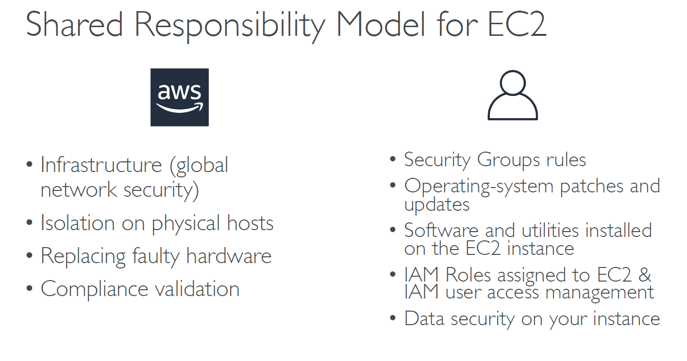
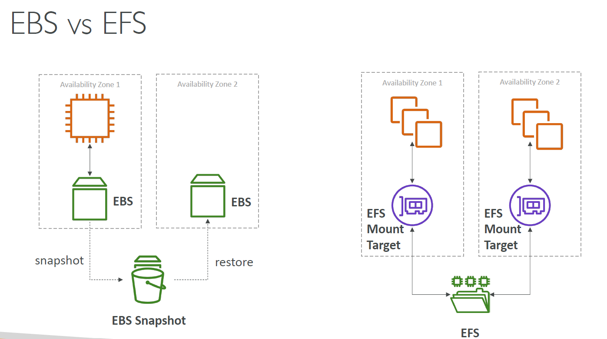
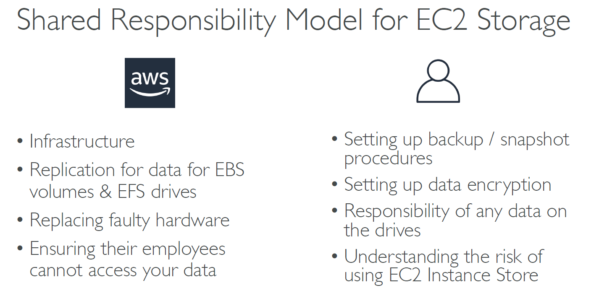

# <u>**Elastic Compute Cloud (EC2)**</u>

EC2 (Elastic Compute Cloud) is a cloud computing service provided by Amazon Web Services (AWS). EC2 is an on-demand computing service on the AWS cloud platform called instances. It allows users to rent virtual servers to run applications in the cloud. You pay only for what you use.

Amazon EC2 is one of the most widely used AWS services because it provides scalable and secure virtual servers in the cloud. Organizations use EC2 to host websites, deploy applications, run databases, and support enterprise workloads without investing in physical hardware. The name 'Elastic Compute Cloud' can be explained as,

- **Elastic** : You can easily increase or decrease the number of instances or their size as your needs change.
- **Compute** : It provides the processing power, memory, and storage for your workloads.
- **Cloud** : It runs on AWS's massive, global data center infrastructure.

### **Features of EC2**

- _Functionality_ : It provides a virtual computing platform to run operations, launch instances, and fully customize the environment. Enhances security and allows configuration changes at any time. Offers default AMIs and supports custom AMIs to be reused with existing/preferred configurations.
- _Operating Systems_ : Provides a wide selection of operating systems when choosing an AMI. Allows users to upload and use their own operating systems.
- _Software_ : Leads the cloud computing market with diverse EC2 options. Allows users to choose from a wide range of software for EC2 instances.
- _Scalability and Reliability_ : Handles dynamic traffic scenarios efficiently. Provides reliable performance through flexible volumes and snapshots. Allows scaling up or down based on changing workload requirements.

### **Core Components of EC2 Instance**

1. <u>_**Amazon Machine Image (AMI)**_</u> : Amazon Machine Image (AMI) Provides thousands of AMIs from AWS, the community, and AWS Marketplace. It allows users to create custom AMIs for reuse and consistency. Acts as a software blueprint containing the operating system, patches, and required software.

- An Amazon Machine Image (AMI) is a template containing the software configuration (operating system, application server, and applications) required to launch an Amazon EC2 instance.
  - Every EC2 instance, whether one or thousands, starts as a clone of the selected AMI.
  - Every AMI packages a root volume template, launch permissions, and a block device mapping.
  - AMIs exist in a single AWS Region and must be explicitly copied to be used in another.
  - AMIs are created, registered, copied, and deregistered. Deregistering does not automatically delete the underlying EBS snapshot.
  - AMIs come from Amazon, the AWS Marketplace, the community, or your own custom builds.
- Core Components of AMI :
  - Root Volume Template : A snapshot of the root volume (typically EBS) containing the OS and all installed software.
  - Launch Permissions : Controls which AWS accounts are authorized to use the AMI to launch instances.
  - Block Device Mapping : Specifies which volumes (root and any additional storage) are attached to the instance at launch.
  - The AMI storage types comes in two types - **EBS-Backed AMI** & **Instance Store-Backed AMI**

2. <u>_**EC2 Instance Types**_</u> : Instance types are the hardware profiles of your virtual server. AWS offers a vast array of instance types optimized for different tasks, grouped into families.

- **t family (e.g., t2.micro, t3.large)** : General Purpose, burstable instances. Perfect for web servers, development environments, and small databases.
- **m family (e.g., m5.xlarge)** : General Purpose, balanced instances with a good mix of CPU, memory, and networking.
- **c family (e.g., c5.large)** : Compute Optimized, with a high ratio of CPU power to memory. Ideal for CPU-intensive tasks like batch processing, media transcoding, and scientific modeling.
- **r family (e.g., r5.large)** : Memory Optimized, with a high ratio of memory to CPU. Used for memory-intensive applications like large databases or in-memory caches.
- **g family (e.g., g4dn.xlarge)** : GPU-based instances designed for machine learning, graphics processing, and video rendering.

**EC2 Instance Naming convention** : Instance type names like "c7gn.2xlarge" follow a logical pattern.

---

#### _EC2 Instance Type Categories_ :

AWS groups EC2 instances into several families based on target use cases.

- i. **General Purpose Instances** : It provide a balanced mix of compute, memory, and networking, suitable for workloads that don't require specialized hardware but need reliable overall performance.
  - Balanced CPU, memory, and network capabilities.
  - Versatile across many different workload types.
  - Cost-effective for common, everyday use cases.
  - _Use Cases_ : Hosting web servers and scalable web applications, Building, testing, and deploying applications in development environments, Hosting content delivery networks (CDNs) with low latency and high throughput.

- ii. **Compute Optimized Instances** : It is designed for tasks that require significant processing power, prioritizing CPU performance over memory.
  - High CPU-to-memory ratio.
  - Optimized for compute-intensive, parallelizable workloads.
  - Graviton-powered variants (e.g., C7g) offer significant price-performance improvements.
  - _Use Cases_ : Batch processing and high-performance web servers, Scientific modeling and media transcoding, Machine learning inference and dedicated gaming servers.

- iii. **Memory Optimized Instances** : It deliver a large amount of RAM relative to CPU, designed for applications that process large datasets entirely in memory.
  - High memory capacity with fast access and low latency.
  - Enhanced networking and storage support.
  - Suited for workloads where RAM is the primary bottleneck.
  - _Use Cases_ : High-performance relational and NoSQL databases, Big data analytics (Apache Spark, Hadoop), Real-time data streaming and in-memory caches (Redis, Memcached).

- iv. **Storage Optimized Instances** : It delivers high-throughput, low-latency local storage, designed for workloads with heavy read/write access to large datasets.
  - High-speed, low-latency local NVMe SSDs.
  - Optimized for large sequential I/O operations.
  - Enhanced networking for fast data transfer.
  - _Use Cases_ : Data warehousing and big data analytics, High-frequency OLTP (Online Transaction Processing), Distributed file systems and log or data processing applications.

- v. **Accelerated Computing Instances** : It includes specialized hardware such as GPUs or FPGAs to perform specific tasks far faster than standard CPUs.
  - Equipped with NVIDIA GPUs, AWS Inferentia, AWS Trainium, or FPGAs.
  - High parallel processing power.
  - Optimized for compute-intensive and graphics-heavy tasks.
  - _Use Cases_ : Machine learning training and inference, Video rendering and transcoding, Scientific simulations and financial risk analysis (HPC).

3. <u>_**Elastic Block Store (EBS) Volumes**_</u> : Elastic Block Store (EBS) provides durable, block-level storage attached to EC2 instances. It acts as a virtual hard drive for storing data. It persists data independently and can be detached and reattached to different instances

---

### AWS Elastic Block Store(EBS)

It is a high-performance, persistent block storage service designed for use with Amazon Elastic Compute Cloud (EC2). Amazon EBS works like a virtual hard drive for EC2 instances. It is designed for workloads that require low latency, high IOPS, and durable storage. It provides :

- Persistent storage that remains available even after an EC2 instance stops or terminates.
- Delivers low latency and high IOPS for transactional workloads.
- Automatically replicates data within the same Availability Zone. But its locked to an Availability Zone (AZ) such as an EBS Volume in us-east-1a cannot be attached to us-east-1b. To move a volume across, you first need to snapshot it
- Supports Elastic Volumes for dynamic resizing and performance tuning.
- It’s a network drive (i.e. not a physical drive). It uses the network to communicate the instance, which means there might be a bit of
  latency. It can be detached from an EC2 instance and attached to another one quickly.
- Have a provisioned capacity (size in GBs, and IOPS). You get billed for all the provisioned capacity. You can increase the capacity of the drive over time.

Amazon EBS provides several native features designed to manage enterprise storage requirements efficiently :

- Elastic Volumes : Modify storage type, capacity, and performance dynamically without downtime.
- Incremental Snapshots : EBS snapshots are incremental backups stored internally in Amazon S3.
- Fast Snapshot Restore (FSR) : Removes initialization delay and delivers fully provisioned volumes immediately after restoration.
- EBS Multi-Attach : Attach a single io1 or io2 volume to multiple EC2 instances within the same Availability Zone.
- High Durability : Provides highly durable storage with durability levels ranging from 99.8% to 99.999% depending on the volume type.
- Native Encryption : Encrypts data at rest, in transit, snapshots, and attached volumes using AWS Key Management Service (KMS).

**EBS – Delete on Termination attribute** : It controls the EBS behaviour when an EC2 instance terminates.

- By default, the root EBS volume is deleted (attribute enabled)
- By default, any other attached EBS volume is not deleted (attribute disabled)
- Use case: preserve root volume when instance is terminated

- **EBS Volumes** : An Amazon EBS volume is a durable, block-level storage device that you can attach to your instances. After you attach a volume to an instance, you can use it as you would use a physical hard drive. EBS volumes are flexible. For current-generation volumes attached to current-generation instance types, you can dynamically increase size, modify the provisioned IOPS capacity, and change volume type on live production volumes.
  - You can use EBS volumes as primary storage for data that requires frequent updates, such as the system drive for an instance or storage for a database application. You can also use them for throughput-intensive applications that perform continuous disk scans. EBS volumes persist independently from the running life of an EC2 instance.
  - You can attach multiple EBS volumes to a single instance. The volume and instance must be in the same Availability Zone.
  - Amazon EBS provides the following volume types: General Purpose SSD (gp2 and gp3), Provisioned IOPS SSD (io1 and io2), Throughput Optimized HDD (st1), Cold HDD (sc1), and Magnetic (standard). They differ in performance characteristics and price, allowing you to tailor your storage performance and cost to the needs of your applications.

- **Features of Amazon EBS volumes** :-
- _**Data availability**_ : When you create an EBS volume, it is automatically replicated within its Availability Zone to prevent data loss due to failure of any single hardware component. You can attach an EBS volume to any EC2 instance in the same Availability Zone.
  - After you attach a volume, it appears as a native block device similar to a hard drive or other physical device. At that point, the instance can interact with the volume just as it would with a local drive.
  - You can connect to the instance and format the EBS volume with a file system, such as Ext4 for a Linux instance or NTFS for a Windows instance, and then install applications.
  - If you attach multiple volumes to a device that you have named, you can stripe data across the volumes for increased I/O and throughput performance.
- **Data persistence** : An EBS volume is off-instance storage that can persist independently from the life of an instance. You continue to pay for the volume usage as long as the data persists.
  - EBS volumes that are attached to a running instance can automatically detach from the instance with their data intact when the instance is terminated if you uncheck the Delete on Termination check box when you configure EBS volumes for your instance on the EC2 console. The volume can then be reattached to a new instance, enabling quick recovery. If the check box for Delete on Termination is checked, the volume(s) will delete upon termination of the EC2 instance.
  - If you are using an EBS-backed instance, you can stop and restart that instance without affecting the data stored in the attached volume. The volume remains attached throughout the stop-start cycle. This enables you to process and store the data on your volume indefinitely, only using the processing and storage resources when required. The data persists on the volume until the volume is deleted explicitly.
  - The physical block storage used by deleted EBS volumes is overwritten with zeroes or cryptographically pseudorandom data before it is allocated to a new volume. If you are dealing with sensitive data, you should consider encrypting your data manually or storing the data on a volume protected by Amazon EBS encryption.
  - By default, the root EBS volume that is created and attached to an instance at launch is deleted when that instance is terminated. You can modify this behavior by changing the value of the flag DeleteOnTermination to false when you launch the instance. This modified value causes the volume to persist even after the instance is terminated, and enables you to attach the volume to another instance.
  - By default, additional EBS volumes that are created and attached to an instance at launch are not deleted when that instance is terminated. You can modify this behavior by changing the value of the flag DeleteOnTermination to true when you launch the instance. This modified value causes the volumes to be deleted when the instance is terminated.
- **Data encryption** : For simplified data encryption, you can create encrypted EBS volumes with the Amazon EBS encryption feature. All EBS volume types support encryption. You can use encrypted EBS volumes to meet a wide range of _data-at-rest_ encryption requirements for regulated/audited data and applications.
  - Amazon EBS encryption uses 256-bit Advanced Encryption Standard algorithms (AES-256) and an Amazon-managed key infrastructure. The encryption occurs on the server that hosts the EC2 instance, providing encryption of _data-in-transit_ from the EC2 instance to Amazon EBS storage.
  - Amazon EBS encryption uses AWS KMS keys when creating encrypted volumes and any snapshots created from your encrypted volumes. The first time you create an encrypted EBS volume in a Region, a default AWS managed KMS key is created for you automatically.
  - This key is used for Amazon EBS encryption unless you create and use a customer managed key. Creating your own customer managed key gives you more flexibility, including the ability to create, rotate, disable, define access controls, and audit the encryption keys used to protect your data.
- **Data security** : Amazon EBS volumes are presented to you as raw, unformatted block devices. These devices are logical devices that are created on the EBS infrastructure and the Amazon EBS service ensures that the devices are logically empty (that is, the raw blocks are zeroed or they contain cryptographically pseudorandom data) prior to any use or re-use by a customer.

- _**Amazon EBS volume types**_ : Amazon EBS provides the following volume types, which differ in performance characteristics and price, so that you can tailor your storage performance and cost to the needs of your applications.
  - **Solid state drive (SSD) volumes (High IOPS & Low Latency)** : SSD-backed volumes are optimized for transactional workloads involving frequent read/write operations with small I/O size, where the dominant performance attribute is IOPS. SSD-backed volume types include General Purpose SSD and Provisioned IOPS SSD .
    - _gp3 (General Purpose SSD)_ : Latest-generation default choice for most workloads (boot volumes, dev/test, small databases, virtual desktops). Scales IOPS and throughput independently of storage size.
    - _gp2 (General Purpose SSD)_ : Previous-generation general-purpose SSD where performance scales with volume size and uses burst credits.
    - _io2 Block Express (Provisioned IOPS SSD)_ : Highest-performance SSD volume for mission-critical, high-IOPS databases (e.g., SAP HANA, SQL Server, Oracle) with 99.999% durability.
    - _io1 (Provisioned IOPS SSD)_ : Previous-generation provisioned IOPS SSD for demanding, IOPS-intensive workloads.
  - **Hard disk drive (HDD) volumes (High Throughput, Non-Boot)** : HDD-backed volumes are optimized for large streaming workloads where the dominant performance attribute is throughput. HDD volume types include Throughput Optimized HDD and Cold HDD.
    - _st1 (Throughput Optimized HDD)_ : Designed for frequently accessed, throughput-intensive workloads such as big data, data warehousing, and log processing.
    - _sc1 (Cold HDD)_ : Lowest-cost HDD option for less frequently accessed, sequential data where cost matters more than speed
  - **Previous generation volumes** : Magnetic (standard) volumes are previous generation volumes that are backed by magnetic drives. They are suited for workloads with small datasets where data is accessed infrequently and performance is not of primary importance. These volumes deliver approximately 100 IOPS on average, with burst capability of up to hundreds of IOPS, and they can range in size from 1 GiB to 1 TiB.
    - _standard (Magnetic)_ : Legacy volume type suited only for small, infrequently accessed datasets or archives

- **Amazon EBS volume lifecycle** : The lifecycle of an Amazon EBS volume starts with the creation process. You can create a volume from an Amazon EBS snapshot or you can create an empty volume.
  - Before you can use your volume, you must attach it to one or more Amazon EC2 instances that are in the same Availability Zone as the volume. You can attach multiple volumes to an instance.
  - If needed, you can detach a volume from one instance and then attach it to another instance. If your storage requirements change, you can modify the size or performance of the volume at any time.
  - You can create point-in-time backups of your volumes by creating Amazon EBS snapshots.
  - If you no longer need a volume, you can delete it to stop incurring the related storage costs.
  - The following image shows actions that you can perform on your volumes as part of the volume lifecycle. There are also tasks that you perform by connecting to the instance and running an operating system command. For example, formatting the volume, mounting the volume, managing partitions, and viewing the free disk space.

    

- **Amazon EBS volume status checks** : Volume status checks enable you to better understand, track, and manage potential inconsistencies in the data on an Amazon EBS volume. They are designed to provide you with the information that you need to determine whether your Amazon EBS volumes are impaired, and to help you control how a potentially inconsistent volume is handled.
  - Volume status checks are automated tests that run every 5 minutes and return a pass or fail status. If all checks pass, the status of the volume is ok. If a check fails, the status of the volume is impaired. If the status is insufficient-data, the checks may still be in progress on the volume. You can view the results of volume status checks to identify any impaired volumes and take any necessary actions.
  - When Amazon EBS determines that a volume's data is potentially inconsistent, the default is that it disables I/O to the volume from any attached EC2 instances, which helps to prevent data corruption. After I/O is disabled, the next volume status check fails, and the volume status is impaired.
    - In addition, you'll see an event that lets you know that I/O is disabled, and that you can resolve the impaired status of the volume by enabling I/O to the volume. EBS waits until you enable I/O to give you the opportunity to decide whether to continue to let your instances use the volume, or to run a consistency check using a command, such as fsck (Linux instances) or chkdsk (Windows instances), before doing so.

- **EBS Snapshots** : Amazon EBS snapshots are incremental, point-in-time backups of Amazon Elastic Block Store (EBS) volumes stored in Amazon S3. You make a backup (snapshot) of your EBS volume at a point in time. Not necessary to detach volume to do snapshot, but recommended. You can copy snapshots across AZ or Regions. A snapshot is an incremental backup, which means that we save only the blocks on the volume that have changed since the most recent snapshot. This minimizes the time required to create the snapshot and saves on storage costs by not duplicating data.
  - Snapshots are stored in Amazon S3, in S3 buckets that you can't access directly. You can create and manage your snapshots using the Amazon EC2 console or the Amazon EC2 API. You can't access your snapshots using the Amazon S3 console or the Amazon S3 API.
  - Snapshot data is automatically replicated across all Availability Zones in the Region. This provides high availability and durability for snapshot data, and enables you to restore volumes in any Availability Zones in that Region.
  - Each snapshot contains all of the information that is needed to restore your data (from the moment when the snapshot was taken) to a new EBS volume. When you create an EBS volume from a snapshot, the new volume begins as an exact replica of the volume that was used to create the snapshot.

- **How Amazon EBS snapshots work** : The first snapshot that you create from a volume is always a full snapshot. It includes all of the data blocks written to the volume at the time of creating the snapshot. Subsequent snapshots of the same volume are incremental snapshots. They include only changed and new data blocks written to the volume since the last snapshot was created
  - The size of a full snapshot is determined by the size of the data being backed up, not the size of the source volume. Similarly, the storage costs associated with a full snapshot is determined by the size of the snapshot, not the size of the source volume. For example, you create the first snapshot of a 200 GiB Amazon EBS volume that contains only 50 GiB of data. This results in a full snapshot that is 50 GiB in size, and you are billed for 50 GiB snapshot storage.
  - Similarly, the size and storage costs of an incremental snapshot are determined by the size of any data that was written to the volume since the previous snapshot was created. Continuing the previous example, if you create a second snapshot of the same 200 GiB volume after changing 20 GiB of data and adding 10 GiB of data, the incremental snapshot is 30 GiB in size. You are then billed for that additional 30 GiB snapshot storage.

- **Multiple snapshots of the same volume** : The diagram in this section shows Volume 1, which is 15 GiB in size, at three points in time. A snapshot is taken of each of these three volume states. The diagram specifically shows the following:
  - In State 1, the volume has 10 GiB of data. Snap A is the first snapshot taken of the volume. Snap A is a full snapshot and the entire 10 GiB of data is backed up.
  - In State 2, the volume still contains 10 GiB of data, but only 4 GiB have changed after Snap A was taken. Snap B is an incremental snapshot. It needs to back up only the 4 GiB that changed. The other 6 GiB of unchanged data, which are already backed up in Snap A, are referenced by Snap B rather than being backed up again. This is indicated by the dashed arrow.
  - In State 3, 2 GiB of data have been added to the volume, for a total of 12 GiB, after Snap B was taken. Snap C is an incremental snapshot. It needs to back up only the 2 GiB that were added after Snap B was taken. As shown by the dashed arrows, Snap C also references the 4 GiB of data stored in Snap B, and the 6 GiB of data stored in Snap A.
  - The total storage required for the three snapshots is 16 GiB total. This accounts for 10 GiB for Snap A, 4 GiB for Snap B, and 2 GiB for Snap C.
    

- **Incremental snapshots of different volumes** :
  - The diagram in this section shows how incremental snapshots can be taken from different volumes.
  - Vol 1, which is 14 GiB in size, has 10 GiB of data. Because Snap A is the first snapshot taken of the volume, it is a full snapshot and the entire 10 GiB of data is backed up.
  - Vol 2 is created from Snap A, so it is an exact replica of Vol 1 at the time the snapshot was taken.
  - Over time, 4 GiB of data is added to Vol 2 and the total size of its data is 14 GiB.
  - Snap B is taken from Vol 2. For Snap B, only the 4 GiB of data that was added after the volume was created from Snap A is backed up. The other 10 GiB of unchanged data, which is already stored in Snap A, is referenced by Snap B instead of being backed up again.
  - Snap B is an incremental snapshot of Snap A, even though it was created from a different volume.
    

- Some more features :
  - Incremental Backups : The first snapshot is a full copy of all data blocks on the volume. Later snapshots only save blocks that have changed since the previous backup.
  - Automatic Chain Management : If you delete an older snapshot, only the data blocks unique to that snapshot are deleted; blocks shared with other snapshots in the chain are preserved.
  - Storage Location : Snapshots live in Amazon S3 and are decoupled from specific Availability Zones (AZs), making them portable across regions
  - EBS Snapshot Archive : Move a Snapshot to an ”archive tier” that is 75% cheaper. But it takes within 24 to 72 hours for restoring
    the archive.
  - Recycle Bin for EBS Snapshots : Setup rules to retain deleted snapshots so you can recover them after an accidental deletion. You can specify retention (from 1 day to 1 year)
  - Fast Snapshot Restore (FSR) : Eliminates initial read latency ("warming up") on newly restored volumes, though it incurs extra costs
  - Automation : You can schedule and manage lifecycle policies using Amazon Data Lifecycle Manager (DLM) or AWS Backup.

- **Amazon EBS encryption** : Use Amazon EBS encryption as a straight-forward encryption solution for your Amazon EBS resources associated with your Amazon EC2 instances. With Amazon EBS encryption, you aren't required to build, maintain, and secure your own key management infrastructure. Amazon EBS encryption uses AWS KMS keys when creating encrypted volumes and snapshots.
  - Encryption operations occur on the servers that host EC2 instances, ensuring the security of both data-at-rest and data-in-transit between an instance and its attached EBS storage.
  - You can attach both encrypted and unencrypted volumes to an instance simultaneously. All Amazon EC2 instance types support Amazon EBS encryption.
  - _Encrypt EBS resources_ : You encrypt EBS volumes by enabling encryption, either using encryption by default or by enabling encryption when you create a volume that you want to encrypt.
    - When you encrypt a volume, you can specify the symmetric encryption KMS key to use to encrypt the volume. If you do not specify a KMS key, the KMS key that is used for encryption depends on the encryption state of the source snapshot and its ownership.
    - You cannot change the KMS key that is associated with an existing snapshot or volume. However, you can associate a different KMS key during a snapshot copy operation so that the resulting copied snapshot is encrypted by the new KMS key.
  - _Encrypt an empty volume on creation_ : When you create a new, empty EBS volume, you can encrypt it by enabling encryption for the specific volume creation operation. If you enabled EBS encryption by default, the volume is automatically encrypted using your default KMS key for EBS encryption.
    - Alternatively, you can specify a different symmetric encryption KMS key for the specific volume creation operation. The volume is encrypted by the time it is first available, so your data is always secured.
    - By default, the KMS key that you selected when creating a volume encrypts the snapshots that you make from the volume and the volumes that you restore from those encrypted snapshots. You cannot remove encryption from an encrypted volume or snapshot, which means that a volume restored from an encrypted snapshot, or a copy of an encrypted snapshot, is always encrypted.

- **AWS Backup for Amazon Elastic Block Store** : AWS Backup is a fully managed service that centralizes and automates data protection across your entire AWS environment. Rather than managing snapshot schedules and retention per resource, you define a single backup policy and apply it across accounts and Regions.
  - Tag your resources and AWS Backup protects them automatically, with no per-team configuration required. The service supports many AWS services, including Amazon EBS, Amazon EC2, Amazon S3, Amazon EFS, Amazon RDS, and Aurora. As a result, one policy can protect volumes, databases, file systems, and object stores together without separate backup tools per workload.
  - For Amazon EBS, AWS Backup delivers crash-consistent, multi-volume snapshots that coordinate point-in-time backups across all volumes attached to an Amazon EC2 instance. This is essential for databases and clustered applications that span multiple volumes.
  - AWS Backup Search takes recovery a step further by enabling item-level recovery. You can locate and restore individual files or directories from Amazon EBS snapshots without restoring the entire volume.
  - AWS Backup also adds enterprise-grade security and compliance to your snapshots. Logically air-gapped vaults isolate recovery points from your production environment. Vault Lock enforces immutability. Amazon GuardDuty integration scans backups for malware. Backup Audit Manager continuously evaluates your backup posture and generates audit-ready compliance reports.

---

4. <u>_**Security Groups**_</u> : A security Group acts as a virtual firewall for your EC2 instance, controlling all inbound and outbound traffic. You define rules that specify which protocols (e.g., SSH, HTTP), ports (e.g., 22, 80), and IP address ranges are allowed to send traffic to or receive traffic from your instance.

#### Security Group in AWS

An AWS security group acts as a stateful virtual firewall for your cloud resources, controlling incoming (inbound) and outgoing (outbound) network traffic at the instance level. They are free to use, block all inbound traffic and allow all outbound traffic by default, and contain only allow rules.

**Key Features of Security Group** :

- Stateful behavior: If an inbound request is permitted, the matching response traffic is automatically allowed, regardless of outbound rules.
- Allow rules only : You can only create rules that grant access; explicit "deny" rules do not exist.
- Instance-level protection : Applied directly to Amazon EC2 instances, RDS databases, or other supported AWS resources.
- Multiple attachments : An instance can have multiple security groups, and a single security group can attach to multiple instances.

**Rules and Configurations** :

- Inbound Rules : These outline the types of traffic that are permitted to use the resources. It serves as a virtual firewall, controlling the traffic going in and coming out of a VPC for one or more Amazon EC2 instances or other AWS services.
- Outbound Rules : These regulate the traffic that is permitted to depart from the resources. The destination for incoming traffic is dealt with by outbound rules. They may be forwarded to an alternative Security Group, a CIDR block, a single IPv4 or IPv6 address, or all three.
- VPC : A virtual network called a virtual private cloud enables you to launch Amazon resources into a defined virtual network.
- CIDR : A technique for allocating IP addresses and rerouting Internet Protocol packets is called classless inter-domain routing (CIDR).
- Protocol : A protocol is a collection of guidelines that controls how two devices communicate with one another.
- Port : A port on a computer serves as the communication endpoint for a particular process or service. It is a 16-bit virtual identifier (ranging from 0 to 65,535) used in computer networking to direct incoming and outgoing data packets to the correct application or service running on a device. While an IP address delivers data to the right machine, the port number acts as a specific door that routes that data to the proper program.

**Classic Ports to know** :

- 22 = SSH (Secure Shell) - log into a Linux instance
- 21 = FTP (File Transfer Protocol) – upload files into a file share
- 22 = SFTP (Secure File Transfer Protocol) – upload files using SSH
- 80 = HTTP – access unsecured websites
- 443 = HTTPS – access secured websites
- 3389 = RDP (Remote Desktop Protocol) – log into a Windows instance

---

> What is Firewall : A firewall is a network security device or software program that monitors, filters, and controls incoming and outgoing network traffic based on predefined security rules. It acts as a digital gatekeeper or barrier between a trusted internal network and untrusted external networks like the internet.
>
> How a Firewall Works
>
> - Inspects Packets : It checks data packets—small units of data transmitted over a network—for details like source and destination IP addresses, port numbers, and protocols.
> - Enforces Rules : It compares each packet against pre-configured security policies to decide whether to accept (allow), reject (block with an error), or drop (silently discard) the traffic.
> - Tracks Sessions : Advanced firewalls monitor active connection states to ensure return traffic belongs to a legitimate, established session.

---

5. <u>_**Key Pairs**_</u> : A Key Pairs consisting of a public key and a private key, is the set of security credentials used to prove your identity when connecting to a Linux EC2 instance. AWS stores the public key, and you are responsible for securely storing the private key file (.pem). You will use this private key to SSH into your instance.

**EC2 Pricing Models** : Choosing an instance type is a separate decision from choosing how you pay for it.

- On-Demand: Pay by the second with no commitment. Best for unpredictable workloads and development or testing.
- Savings Plans / Reserved Instances: Commit to a 1 or 3 year term for discounts of up to 72%. Best for steady-state, predictable workloads.
- Spot Instances: Bid on spare EC2 capacity for discounts of up to 90%. Ideal for fault-tolerant, interruption-tolerant workloads like batch processing or data analysis, as AWS can terminate these instances with a two-minute warning.
- Dedicated Hosts : A physical server with EC2 instance capacity fully dedicated to your use. Allows you address compliance requirements and use your existing server-bound software licenses (per-socket, per-core, pe—VM software licenses). Purchasing Options: On-demand – pay per second for active Dedicated Host and Reserved - 1 or 3 years (No Upfront, Partial Upfront, All Upfront)
- Dedicated Instances : Instances run on hardware that’s dedicated to you only. May share hardware with other instances in same account. No control over instance placement (can move hardware after Stop / Start)
- Capacity Reservations : Reserve On-Demand instances capacity in a specific AZ for any duration. You always have access to EC2 capacity when you need it. No time commitment (create/cancel anytime), no billing discounts. Combine with Regional Reserved Instances and Savings Plans to benefit from billing discounts. You’re charged at On-Demand rate whether you run instances or not

_**Amazon Machine Image (AMI)**_ : AMI are a customization of an EC2 instance. It is a pre-configured template that provides the necessary software configuration—including the operating system, application server, and applications—to launch an Amazon EC2 instance.

- Root Volume & Storage : Includes a root volume template with the OS and applications, alongside block device mappings for attached storage volumes. It has a Faster boot / configuration time because all your software is pre-packaged.
- Permissions & Metadata : Features launch permissions controlling account access and metadata defining architecture, virtualization type, and region. AMI are built for a specific region (and can be copied across regions)

**_AMI Lifecycle_** :

- Create : Launch an instance, configure it (install patches, application code), then create an image from it.
- Register: The AMI is registered with a unique ID (e.g., ami-12345678) in a specific AWS Region.
- Copy : AMIs are Region-specific. To use an AMI created in us-east-1 within eu-west-1, you must explicitly copy it to the target Region.
- Deregister : When an AMI is no longer needed, deregister it to stop it from being used to launch new instances.

**Types of AMI's** :

1. Amazon-Provided AMIs : Official, AWS-maintained images for Amazon Linux 2023, Ubuntu, Windows Server, and more.
2. AWS Marketplace AMIs : Paid images provided by third-party vendors, such as pre-hardened CIS Benchmark images or application appliances like WordPress.
3. Community AMIs : Images shared publicly by other AWS users. Use with caution and always verify the source, as they may contain malware or backdoors.
4. Custom AMIs : Your own "Golden Images" that you build, harden, and maintain to meet internal standards.

**EC2 Image Builder** : EC2 builder is a tool provided by AWS cloud providers to create, customize, manage, and distribute EC2 images(AMIs).

- Image Recipes : Blueprints that define the base image (such as Amazon Linux, Windows, or macOS) and components (software to install, shell scripts, or security patches).
- Automation Pipelines : Orchestrate the build, test, store, and distribution phases on a schedule or via manual triggers.
- Built-in Testing : Validates images automatically before deployment using instance tests and security scans.
- Distribution & Lifecycle : Shares images across multiple AWS regions and accounts, while managing automated cleanup or deprecation of older versions.
- Cost : The service itself is free to use, though you pay standard AWS rates for the underlying EC2 instances, EBS storage, and S3 logs utilized during builds.

---

#### EC2 Instance Storage :

EC2 Instance storage is the temporary block storage service offered by AWS. EC2 instance storage, in itself, is not a storage service but a part of the EC2 service. These storage devices physically lie on the same host that provides the EC2 instance and are useful for storing temporary data associated with the EC2 instances.

- With the instance store, you get temporary block-level storage which is associated with each EC2 instance.
- The size, number, and type of instance store volumes that are available depend on the Instance Type used and they are directly hooked onto the underlying host.
- However, this data is not persistent i.e. it will not persist a stop/start of an EC2 instance, Reboot request or even if the EC2 instance terminates for Hardware failures. Below are some of the features,
  - Ephemerality: Data is temporary. It is lost if the instance is stopped, terminated, or if the underlying host hardware fails.
  - Reboot Persistence : Data typically survives if you simply reboot the instance on the same host.
  - High Performance : Because the disks are physically connected to the host (not network-attached like EBS), they offer extremely low latency, very high IOPS, and fast read/write speeds.
  - Cost : There is no extra charge; the storage cost is already included in the EC2 instance pricing.
  - Availability : Not all EC2 instance types support instance stores; they are built into specific instance families (such as M5D, C6GD, or R6GD).
  - No Backups : Instance store volumes do not support native AWS snapshots or backups.

---

#### EFS – Elastic File System :

Amazon Elastic File System (EFS) is a fully managed, serverless, and elastic file storage service provided by AWS. It uses the NFS (Network File System) protocol to provide shared file storage that can be accessed simultaneously by thousands of compute resources, unlike Amazon EBS, which provides block storage for a single EC2 instance. EFS works with Linux EC2 instances in multi-AZ. They are highly available, scalable, expensive (3x gp2), pay per use, no capacity planning.

- Automatically scales storage capacity based on usage.
- Supports simultaneous access from EC2 instances, ECS/EKS containers, and AWS Lambda functions.
- Uses standard NFSv4.0 and NFSv4.1 protocols for Linux systems.
- Automatically replicates data across multiple Availability Zones within a Region for high durability and availability.
- Supports lifecycle policies to move infrequently accessed files to lower-cost storage classes.

**_Working_** : Amazon EFS operates through a regional architecture that replicates data across multiple Availability Zones.

1. File System : The top-level AWS resource representing your shared storage.
2. Mount Targets : Created in each VPC subnet to provide an IP address for EC2 instances or containers to connect to EFS.
3. NFS Protocol : Mounts the file system onto EC2 instances as a standard local directory using NFSv4.
4. Regional Replication: Automatically replicates data across multiple Availability Zones within a region for maximum durability.

**_Use Cases_** : Amazon EFS is widely used in enterprise applications that require scalable and shared file storage.

- Secured File Sharing : Enables secure, fast, and consistent file sharing across multiple instances.
- Web Hosting : Serves as common storage for fleet-based web applications (e.g., WordPress) requiring simultaneous file access.
- Machine Learning and AI Workloads : Stores massive datasets, allowing parallel access by training models across multiple instances.

  

**EFS Infrequent Access (EFS-IA)** : Storage class that is cost-optimized for files not accessed every day. It has up to 92% lower cost compared to EFS Standard. EFS will automatically move your files to EFS-IA based on the last time they were accessed. Enable EFS-IA with a Lifecycle Policy. Example: move files that are not accessed for 60days to EFS-IA. Transparent to the applications accessing EFS.

---

**AWS EC2 Status checks** : An Amazon EC2 status check is an automated test performed by AWS every minute to detect hardware, software, or network issues on your virtual server. It performs 3 types of check for an EC2 instance,

1. _System Status Check_ : Monitors the underlying AWS physical hardware, power, network connectivity, and host systems. If it fails, the issue is on AWS’s side (such as a physical server failure).
2. _Instance Status Check_ : Monitors the internal software and network configuration of your specific virtual machine (such as a corrupted file system, exhausted memory, bad kernel, or invalid network stack). If it fails, the issue is inside your operating system.
3. _Attached EBS Status Check_ : Verifies that the Amazon Elastic Block Store (EBS) volumes attached to your instance can perform input/output operations properly.

> Remote Desktop Protocol (RDP) is a proprietary network protocol developed by Microsoft that lets users connect to and control a remote computer or server with a full graphical interface.
>
> > How It Works
> > Client-Server Model : The computer being controlled runs RDP server software, while the user connects from a local device running RDP client software.
>
> > Input and Output : The server broadcasts real-time screen and audio data to the client, while the client sends keyboard and mouse inputs back to the server.
>
> > Port and Transport : It communicates by default over TCP and UDP port 3389.
> > Underlying Standard : RDP is built on an extension of the ITU-T T.120 family of protocol standards
