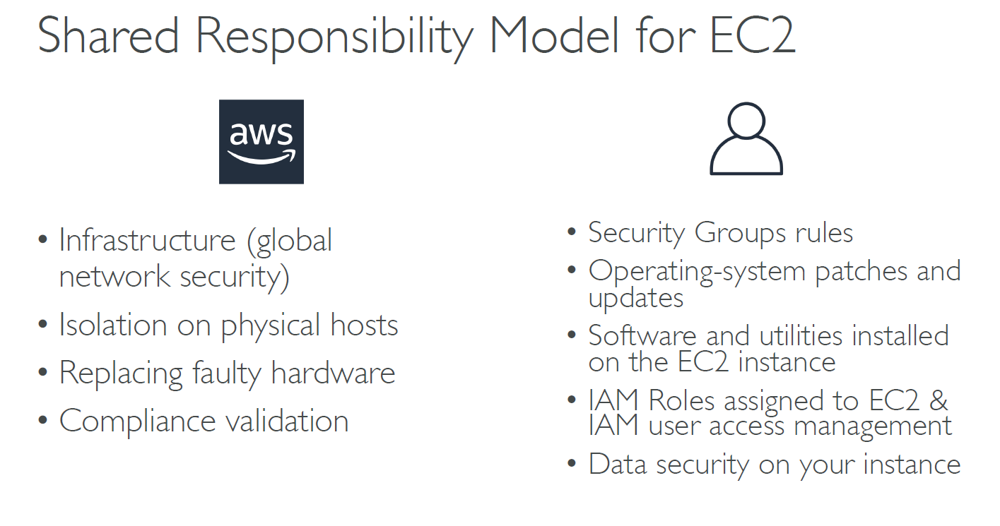
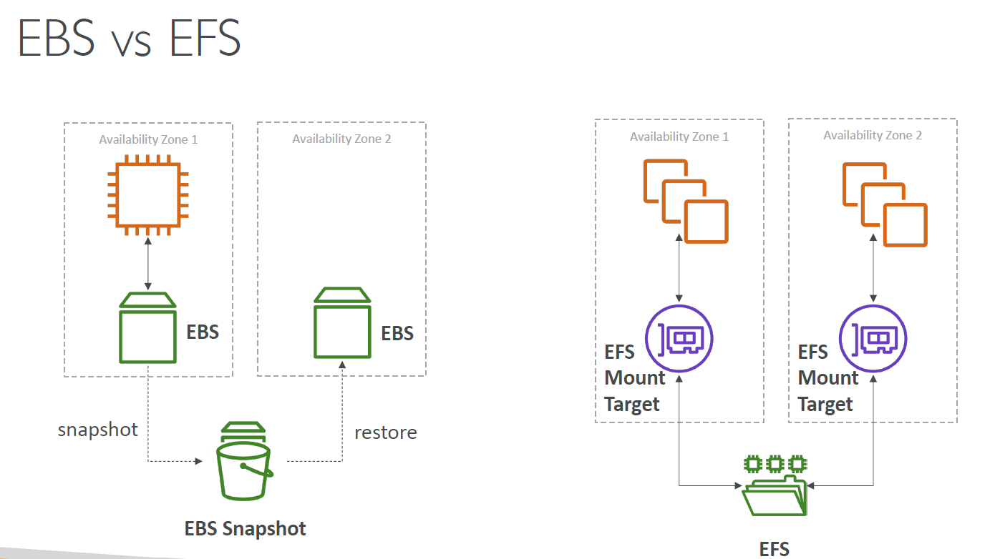
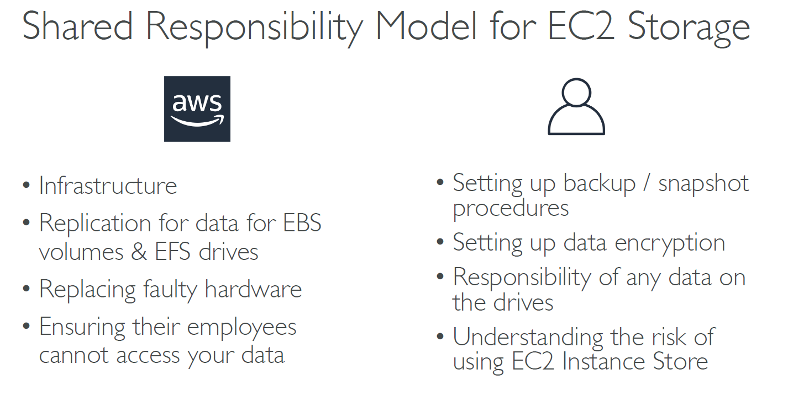

# <u>**Elastic Compute Cloud (EC2)**</u>

EC2 (Elastic Compute Cloud) is a cloud computing service provided by Amazon Web Services (AWS). EC2 is an on-demand computing service on the AWS cloud platform called instances. It allows users to rent virtual servers to run applications in the cloud. You pay only for what you use.

Amazon EC2 is one of the most widely used AWS services because it provides scalable and secure virtual servers in the cloud. Organizations use EC2 to host websites, deploy applications, run databases, and support enterprise workloads without investing in physical hardware. The name 'Elastic Compute Cloud' can be explained as,

- **Elastic** : You can easily increase or decrease the number of instances or their size as your needs change.
- **Compute** : It provides the processing power, memory, and storage for your workloads.
- **Cloud** : It runs on AWS's massive, global data center infrastructure.

### **Features of EC2**

- _Functionality_ : It provides a virtual computing platform to run operations, launch instances, and fully customize the environment. Enhances security and allows configuration changes at any time. Offers default AMIs and supports custom AMIs to be reused with existing/preferred configurations.
- _Operating Systems_ : Provides a wide selection of operating systems when choosing an AMI. Allows users to upload and use their own operating systems.
- _Software_ : Leads the cloud computing market with diverse EC2 options. Allows users to choose from a wide range of software for EC2 instances.
- _Scalability and Reliability_ : Handles dynamic traffic scenarios efficiently. Provides reliable performance through flexible volumes and snapshots. Allows scaling up or down based on changing workload requirements.

### **Core Components of EC2 Instance**

1. <u>_**Amazon Machine Image (AMI)**_</u> : Amazon Machine Image (AMI) Provides thousands of AMIs from AWS, the community, and AWS Marketplace. It allows users to create custom AMIs for reuse and consistency. Acts as a software blueprint containing the operating system, patches, and required software.

- An Amazon Machine Image (AMI) is a template containing the software configuration (operating system, application server, and applications) required to launch an Amazon EC2 instance.
  - Every EC2 instance, whether one or thousands, starts as a clone of the selected AMI.
  - Every AMI packages a root volume template, launch permissions, and a block device mapping.
  - AMIs exist in a single AWS Region and must be explicitly copied to be used in another.
  - AMIs are created, registered, copied, and deregistered. Deregistering does not automatically delete the underlying EBS snapshot.
  - AMIs come from Amazon, the AWS Marketplace, the community, or your own custom builds.
- Core Components of AMI :
  - Root Volume Template : A snapshot of the root volume (typically EBS) containing the OS and all installed software.
  - Launch Permissions : Controls which AWS accounts are authorized to use the AMI to launch instances.
  - Block Device Mapping : Specifies which volumes (root and any additional storage) are attached to the instance at launch.
  - The AMI storage types comes in two types - **EBS-Backed AMI** & **Instance Store-Backed AMI**

2. <u>_**EC2 Instance Types**_</u> : Instance types are the hardware profiles of your virtual server. AWS offers a vast array of instance types optimized for different tasks, grouped into families.

- **t family (e.g., t2.micro, t3.large)** : General Purpose, burstable instances. Perfect for web servers, development environments, and small databases.
- **m family (e.g., m5.xlarge)** : General Purpose, balanced instances with a good mix of CPU, memory, and networking.
- **c family (e.g., c5.large)** : Compute Optimized, with a high ratio of CPU power to memory. Ideal for CPU-intensive tasks like batch processing, media transcoding, and scientific modeling.
- **r family (e.g., r5.large)** : Memory Optimized, with a high ratio of memory to CPU. Used for memory-intensive applications like large databases or in-memory caches.
- **g family (e.g., g4dn.xlarge)** : GPU-based instances designed for machine learning, graphics processing, and video rendering.

**EC2 Instance Naming convention** : Instance type names like "c7gn.2xlarge" follow a logical pattern.

#### _EC2 Instance Type Categories_ :

AWS groups EC2 instances into several families based on target use cases.

- i. **General Purpose Instances** : It provide a balanced mix of compute, memory, and networking, suitable for workloads that don't require specialized hardware but need reliable overall performance.
  - Balanced CPU, memory, and network capabilities.
  - Versatile across many different workload types.
  - Cost-effective for common, everyday use cases.
  - _Use Cases_ : Hosting web servers and scalable web applications, Building, testing, and deploying applications in development environments, Hosting content delivery networks (CDNs) with low latency and high throughput.

- ii. **Compute Optimized Instances** : It is designed for tasks that require significant processing power, prioritizing CPU performance over memory.
  - High CPU-to-memory ratio.
  - Optimized for compute-intensive, parallelizable workloads.
  - Graviton-powered variants (e.g., C7g) offer significant price-performance improvements.
  - _Use Cases_ : Batch processing and high-performance web servers, Scientific modeling and media transcoding, Machine learning inference and dedicated gaming servers.

- iii. **Memory Optimized Instances** : It deliver a large amount of RAM relative to CPU, designed for applications that process large datasets entirely in memory.
  - High memory capacity with fast access and low latency.
  - Enhanced networking and storage support.
  - Suited for workloads where RAM is the primary bottleneck.
  - _Use Cases_ : High-performance relational and NoSQL databases, Big data analytics (Apache Spark, Hadoop), Real-time data streaming and in-memory caches (Redis, Memcached).

- iv. **Storage Optimized Instances** : It delivers high-throughput, low-latency local storage, designed for workloads with heavy read/write access to large datasets.
  - High-speed, low-latency local NVMe SSDs.
  - Optimized for large sequential I/O operations.
  - Enhanced networking for fast data transfer.
  - _Use Cases_ : Data warehousing and big data analytics, High-frequency OLTP (Online Transaction Processing), Distributed file systems and log or data processing applications.

- v. **Accelerated Computing Instances** : It includes specialized hardware such as GPUs or FPGAs to perform specific tasks far faster than standard CPUs.
  - Equipped with NVIDIA GPUs, AWS Inferentia, AWS Trainium, or FPGAs.
  - High parallel processing power.
  - Optimized for compute-intensive and graphics-heavy tasks.
  - _Use Cases_ : Machine learning training and inference, Video rendering and transcoding, Scientific simulations and financial risk analysis (HPC).

3. <u>_**Elastic Block Store (EBS) Volumes**_</u> : Elastic Block Store (EBS) provides durable, block-level storage attached to EC2 instances. It acts as a virtual hard drive for storing data. It persists data independently and can be detached and reattached to different instances

#### AWS Elastic Block Store(EBS)

It is a high-performance, persistent block storage service designed for use with Amazon Elastic Compute Cloud (EC2). Amazon EBS works like a virtual hard drive for EC2 instances. It is designed for workloads that require low latency, high IOPS, and durable storage. It provides :

- Persistent storage that remains available even after an EC2 instance stops or terminates.
- Delivers low latency and high IOPS for transactional workloads.
- Automatically replicates data within the same Availability Zone. But its locked to an Availability Zone (AZ) such as an EBS Volume in us-east-1a cannot be attached to us-east-1b. To move a volume across, you first need to snapshot it
- Supports Elastic Volumes for dynamic resizing and performance tuning.
- It’s a network drive (i.e. not a physical drive). It uses the network to communicate the instance, which means there might be a bit of
  latency. It can be detached from an EC2 instance and attached to another one quickly.
- Have a provisioned capacity (size in GBs, and IOPS). You get billed for all the provisioned capacity. You can increase the capacity of the drive over time.

Amazon EBS provides several native features designed to manage enterprise storage requirements efficiently :

- Elastic Volumes : Modify storage type, capacity, and performance dynamically without downtime.
- Incremental Snapshots : EBS snapshots are incremental backups stored internally in Amazon S3.
- Fast Snapshot Restore (FSR) : Removes initialization delay and delivers fully provisioned volumes immediately after restoration.
- EBS Multi-Attach : Attach a single io1 or io2 volume to multiple EC2 instances within the same Availability Zone.
- High Durability : Provides highly durable storage with durability levels ranging from 99.8% to 99.999% depending on the volume type.
- Native Encryption : Encrypts data at rest, in transit, snapshots, and attached volumes using AWS Key Management Service (KMS).

**EBS – Delete on Termination attribute** : It controls the EBS behaviour when an EC2 instance terminates.

- By default, the root EBS volume is deleted (attribute enabled)
- By default, any other attached EBS volume is not deleted (attribute disabled)
- Use case: preserve root volume when instance is terminated

**EBS Snapshots** : Make a backup (snapshot) of your EBS volume at a point in time. Not necessary to detach volume to do snapshot, but recommended. You can copy snapshots across AZ or Regions.

- EBS Snapshot Archive : Move a Snapshot to an ”archive tier” that is 75% cheaper. But it takes within 24 to 72 hours for restoring
  the archive.
- Recycle Bin for EBS Snapshots : Setup rules to retain deleted snapshots so you can recover them after an accidental deletion. You can specify retention (from 1 day to 1 year)

4. <u>_**Security Groups**_</u> : A security Group acts as a virtual firewall for your EC2 instance, controlling all inbound and outbound traffic. You define rules that specify which protocols (e.g., SSH, HTTP), ports (e.g., 22, 80), and IP address ranges are allowed to send traffic to or receive traffic from your instance.

#### Security Group in AWS

An AWS security group acts as a stateful virtual firewall for your cloud resources, controlling incoming (inbound) and outgoing (outbound) network traffic at the instance level. They are free to use, block all inbound traffic and allow all outbound traffic by default, and contain only allow rules.

**Key Features of Security Group** :

- Stateful behavior: If an inbound request is permitted, the matching response traffic is automatically allowed, regardless of outbound rules.
- Allow rules only : You can only create rules that grant access; explicit "deny" rules do not exist.
- Instance-level protection : Applied directly to Amazon EC2 instances, RDS databases, or other supported AWS resources.
- Multiple attachments : An instance can have multiple security groups, and a single security group can attach to multiple instances.

**Rules and Configurations** :

- Inbound Rules : These outline the types of traffic that are permitted to use the resources. It serves as a virtual firewall, controlling the traffic going in and coming out of a VPC for one or more Amazon EC2 instances or other AWS services.
- Outbound Rules : These regulate the traffic that is permitted to depart from the resources. The destination for incoming traffic is dealt with by outbound rules. They may be forwarded to an alternative Security Group, a CIDR block, a single IPv4 or IPv6 address, or all three.
- VPC : A virtual network called a virtual private cloud enables you to launch Amazon resources into a defined virtual network.
- CIDR : A technique for allocating IP addresses and rerouting Internet Protocol packets is called classless inter-domain routing (CIDR).
- Protocol : A protocol is a collection of guidelines that controls how two devices communicate with one another.
- Port : A port on a computer serves as the communication endpoint for a particular process or service.

**Classic Ports to know** :

- 22 = SSH (Secure Shell) - log into a Linux instance
- 21 = FTP (File Transfer Protocol) – upload files into a file share
- 22 = SFTP (Secure File Transfer Protocol) – upload files using SSH
- 80 = HTTP – access unsecured websites
- 443 = HTTPS – access secured websites
- 3389 = RDP (Remote Desktop Protocol) – log into a Windows instance

> What is Firewall : A firewall is a network security device or software program that monitors, filters, and controls incoming and outgoing network traffic based on predefined security rules. It acts as a digital gatekeeper or barrier between a trusted internal network and untrusted external networks like the internet.
>
> How a Firewall Works
>
> - Inspects Packets : It checks data packets—small units of data transmitted over a network—for details like source and destination IP addresses, port numbers, and protocols.
> - Enforces Rules : It compares each packet against pre-configured security policies to decide whether to accept (allow), reject (block with an error), or drop (silently discard) the traffic.
> - Tracks Sessions : Advanced firewalls monitor active connection states to ensure return traffic belongs to a legitimate, established session.

5. <u>_**Key Pairs**_</u> : A Key Pairs consisting of a public key and a private key, is the set of security credentials used to prove your identity when connecting to a Linux EC2 instance. AWS stores the public key, and you are responsible for securely storing the private key file (.pem). You will use this private key to SSH into your instance.

**EC2 Pricing Models** : Choosing an instance type is a separate decision from choosing how you pay for it.

- On-Demand: Pay by the second with no commitment. Best for unpredictable workloads and development or testing.
- Savings Plans / Reserved Instances: Commit to a 1 or 3 year term for discounts of up to 72%. Best for steady-state, predictable workloads.
- Spot Instances: Bid on spare EC2 capacity for discounts of up to 90%. Ideal for fault-tolerant, interruption-tolerant workloads like batch processing or data analysis, as AWS can terminate these instances with a two-minute warning.
- Dedicated Hosts : A physical server with EC2 instance capacity fully dedicated to your use. Allows you address compliance requirements and use your existing server-bound software licenses (per-socket, per-core, pe—VM software licenses). Purchasing Options: On-demand – pay per second for active Dedicated Host and Reserved - 1 or 3 years (No Upfront, Partial Upfront, All Upfront)
- Dedicated Instances : Instances run on hardware that’s dedicated to you only. May share hardware with other instances in same account. No control over instance placement (can move hardware after Stop / Start)
- Capacity Reservations : Reserve On-Demand instances capacity in a specific AZ for any duration. You always have access to EC2 capacity when you need it. No time commitment (create/cancel anytime), no billing discounts. Combine with Regional Reserved Instances and Savings Plans to benefit from billing discounts. You’re charged at On-Demand rate whether you run instances or not

_**Amazon Machine Image (AMI)**_ : AMI are a customization of an EC2 instance. It is a pre-configured template that provides the necessary software configuration—including the operating system, application server, and applications—to launch an Amazon EC2 instance.

- Root Volume & Storage : Includes a root volume template with the OS and applications, alongside block device mappings for attached storage volumes. It has a Faster boot / configuration time because all your software is pre-packaged.
- Permissions & Metadata : Features launch permissions controlling account access and metadata defining architecture, virtualization type, and region. AMI are built for a specific region (and can be copied across regions)

**_AMI Lifecycle_** :

- Create : Launch an instance, configure it (install patches, application code), then create an image from it.
- Register: The AMI is registered with a unique ID (e.g., ami-12345678) in a specific AWS Region.
- Copy : AMIs are Region-specific. To use an AMI created in us-east-1 within eu-west-1, you must explicitly copy it to the target Region.
- Deregister : When an AMI is no longer needed, deregister it to stop it from being used to launch new instances.

**Types of AMI's** :

1. Amazon-Provided AMIs : Official, AWS-maintained images for Amazon Linux 2023, Ubuntu, Windows Server, and more.
2. AWS Marketplace AMIs : Paid images provided by third-party vendors, such as pre-hardened CIS Benchmark images or application appliances like WordPress.
3. Community AMIs : Images shared publicly by other AWS users. Use with caution and always verify the source, as they may contain malware or backdoors.
4. Custom AMIs : Your own "Golden Images" that you build, harden, and maintain to meet internal standards.

**EC2 Image Builder** : EC2 builder is a tool provided by AWS cloud providers to create, customize, manage, and distribute EC2 images(AMIs).

- Image Recipes : Blueprints that define the base image (such as Amazon Linux, Windows, or macOS) and components (software to install, shell scripts, or security patches).
- Automation Pipelines : Orchestrate the build, test, store, and distribution phases on a schedule or via manual triggers.
- Built-in Testing : Validates images automatically before deployment using instance tests and security scans.
- Distribution & Lifecycle : Shares images across multiple AWS regions and accounts, while managing automated cleanup or deprecation of older versions.
- Cost : The service itself is free to use, though you pay standard AWS rates for the underlying EC2 instances, EBS storage, and S3 logs utilized during builds.

**EC2 Instance Storage** : EC2 Instance storage is the temporary block storage service offered by AWS. EC2 instance storage, in itself, is not a storage service but a part of the EC2 service. These storage devices physically lie on the same host that provides the EC2 instance and are useful for storing temporary data associated with the EC2 instances.

- With the instance store, you get temporary block-level storage which is associated with each EC2 instance.
- The size, number, and type of instance store volumes that are available depend on the Instance Type used and they are directly hooked onto the underlying host.
- However, this data is not persistent i.e. it will not persist a stop/start of an EC2 instance, Reboot request or even if the EC2 instance terminates for Hardware failures. Below are some of the features,
  - Ephemerality: Data is temporary. It is lost if the instance is stopped, terminated, or if the underlying host hardware fails.
  - Reboot Persistence : Data typically survives if you simply reboot the instance on the same host.
  - High Performance : Because the disks are physically connected to the host (not network-attached like EBS), they offer extremely low latency, very high IOPS, and fast read/write speeds.
  - Cost : There is no extra charge; the storage cost is already included in the EC2 instance pricing.
  - Availability : Not all EC2 instance types support instance stores; they are built into specific instance families (such as M5D, C6GD, or R6GD).
  - No Backups : Instance store volumes do not support native AWS snapshots or backups.

**EFS – Elastic File System** : Amazon Elastic File System (EFS) is a fully managed, serverless, and elastic file storage service provided by AWS. It uses the NFS (Network File System) protocol to provide shared file storage that can be accessed simultaneously by thousands of compute resources, unlike Amazon EBS, which provides block storage for a single EC2 instance. EFS works with Linux EC2 instances in multi-AZ. They are highly available, scalable, expensive (3x gp2), pay per use, no capacity planning.

- Automatically scales storage capacity based on usage.
- Supports simultaneous access from EC2 instances, ECS/EKS containers, and AWS Lambda functions.
- Uses standard NFSv4.0 and NFSv4.1 protocols for Linux systems.
- Automatically replicates data across multiple Availability Zones within a Region for high durability and availability.
- Supports lifecycle policies to move infrequently accessed files to lower-cost storage classes.

**_Working_** : Amazon EFS operates through a regional architecture that replicates data across multiple Availability Zones.

1. File System : The top-level AWS resource representing your shared storage.
2. Mount Targets : Created in each VPC subnet to provide an IP address for EC2 instances or containers to connect to EFS.
3. NFS Protocol : Mounts the file system onto EC2 instances as a standard local directory using NFSv4.
4. Regional Replication: Automatically replicates data across multiple Availability Zones within a region for maximum durability.

**_Use Cases_** : Amazon EFS is widely used in enterprise applications that require scalable and shared file storage.

- Secured File Sharing : Enables secure, fast, and consistent file sharing across multiple instances.
- Web Hosting : Serves as common storage for fleet-based web applications (e.g., WordPress) requiring simultaneous file access.
- Machine Learning and AI Workloads : Stores massive datasets, allowing parallel access by training models across multiple instances.

  

**EFS Infrequent Access (EFS-IA)** : Storage class that is cost-optimized for files not accessed every day. It has up to 92% lower cost compared to EFS Standard. EFS will automatically move your files to EFS-IA based on the last time they were accessed. Enable EFS-IA with a Lifecycle Policy. Example: move files that are not accessed for 60days to EFS-IA. Transparent to the applications accessing EFS.

